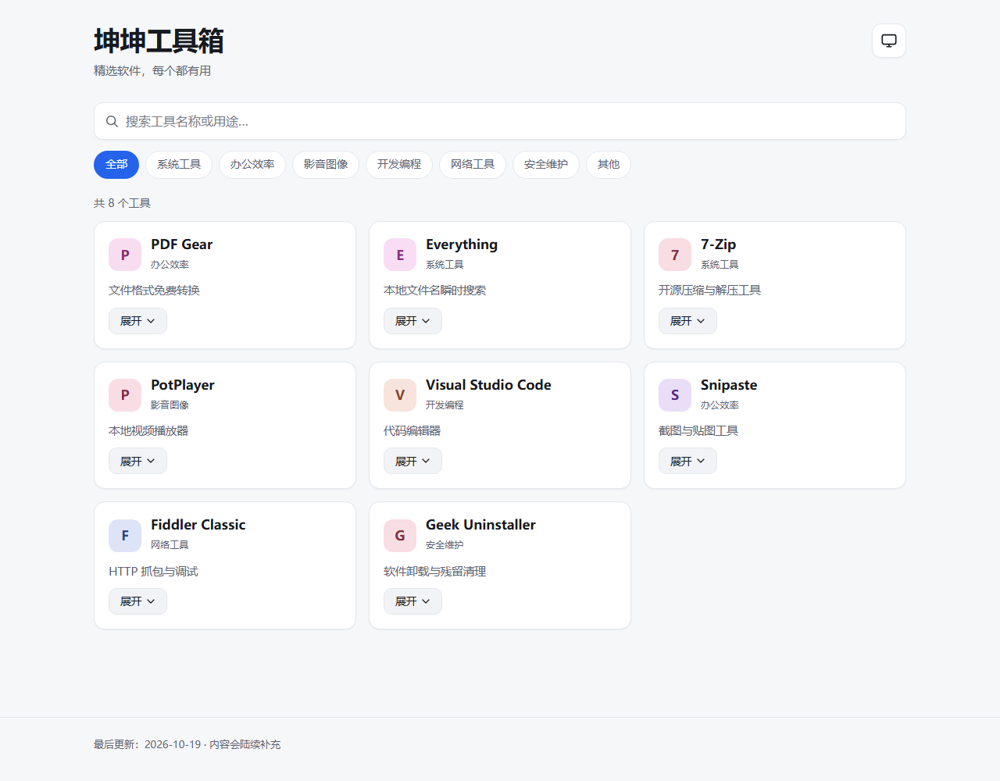
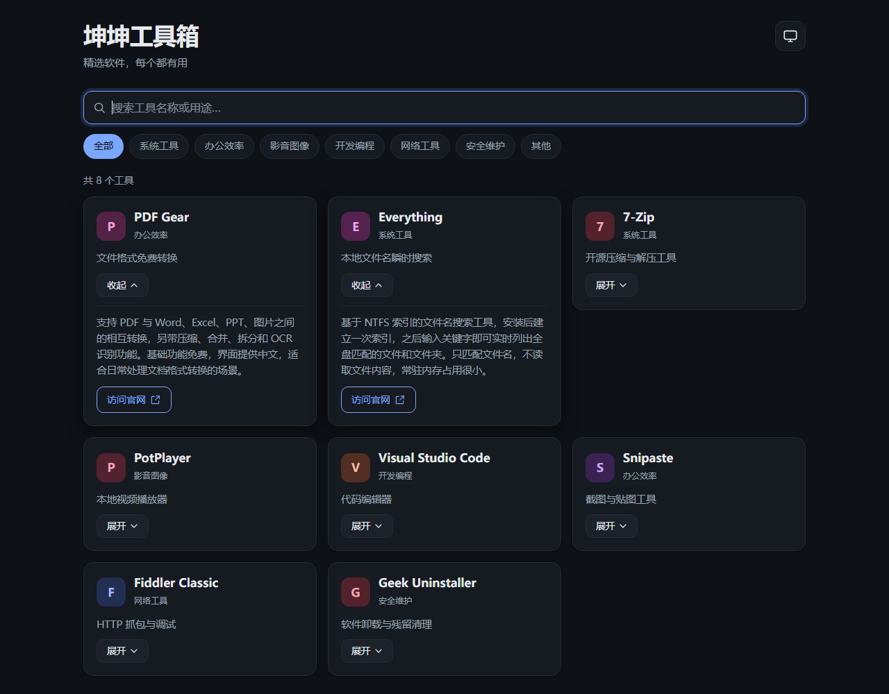
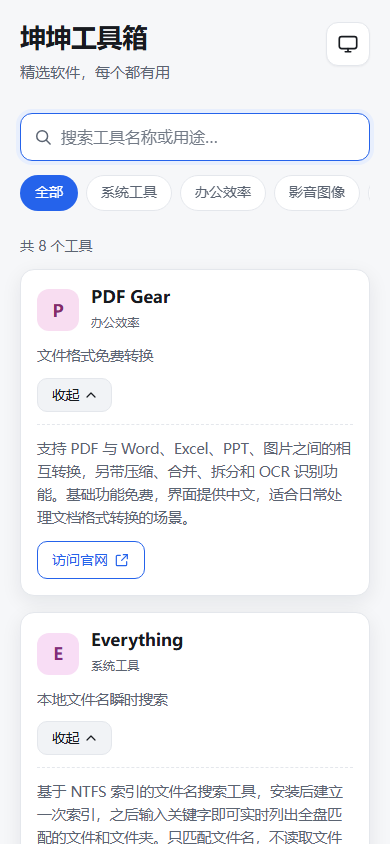

# 坤坤工具箱

把自己常用、觉得好用的软件整理成一页，写明用途和官网，方便浏览和查找。

纯静态页面：没有构建步骤、没有第三方依赖、没有后端，双击 `index.html` 就能看，也可以直接丢到任意静态托管上。

**线上地址：<https://fangshi006.github.io/kkgongju/>**（GitHub Pages 托管）

## 效果预览

| 桌面浅色 | 桌面深色 | 手机 |
| --- | --- | --- |
|  |  |  |

## 文件说明

| 文件 | 作用 |
| --- | --- |
| `index.html` | 页面骨架（头部、搜索框、卡片容器、页脚） |
| `style.css` | 全部样式，含深色/浅色两套配色与手机适配 |
| `app.js` | 渲染卡片、搜索、分类筛选、展开详情、主题切换 |
| `data.js` | **工具清单**，日常只需要改这个文件 |
| `server.js` | 本地 HTTPS 预览服务（零依赖，部署时不需要） |
| `certs/` | 自签名证书，配合 `server.js` 使用（部署时不需要） |
| `docs/项目构想.md` | 需求与设计决策记录 |
| `.gitignore` | 排除证书、压缩包等不该上传的文件 |

## 本地预览

最简单：直接双击 `index.html` 用浏览器打开。

### HTTP 预览

在项目目录执行任意静态服务器，例如：

```bash
python -m http.server 8000
```

然后访问 <http://localhost:8000>。

### HTTPS 预览

需要 `https://localhost:3000` 这类安全上下文时（有些浏览器特性只在 HTTPS 下生效），项目自带一个零依赖的 HTTPS 服务：

```powershell
node server.js
```

然后打开 <https://localhost:3000>。

- 证书是自签名的（放在 `certs/`，有效期至 2029-01-21），浏览器首次访问会提示"您的连接不是私密连接"，点 **高级 → 继续前往 localhost（不安全）** 即可，不影响本地预览。
- 换端口：`$env:PORT=4000; node server.js`
- 允许同一局域网的手机访问：`$env:HOST=0.0.0.0; node server.js`（Windows 防火墙弹窗时选择允许），手机访问 `https://电脑IP:3000`，同样需要跳过证书警告。
- 证书过期或失效时重新生成（用 Git 自带的 openssl）：

  ```powershell
  openssl req -x509 -newkey rsa:2048 -sha256 -days 825 -nodes `
    -keyout certs/localhost-key.pem -out certs/localhost-cert.pem `
    -subj "/CN=localhost" -addext "subjectAltName=DNS:localhost,IP:127.0.0.1,IP:::1"
  ```

## 添加或修改工具

只改 `data.js`，在 `window.TOOLS` 数组里增删对象：

```js
{
  name: "工具名称",
  desc: "一句话简介（卡片上显示）",
  detail: "长介绍，卡片展开后显示，建议 2~4 句。",
  url: "https://官网地址/",   // 可留空，留空则不显示"访问官网"按钮
  category: "办公效率"        // 必须是下面 7 个分类之一
}
```

分类固定为 7 个：`系统工具`、`办公效率`、`影音图像`、`开发编程`、`网络工具`、`安全维护`、`其他`。

改完保存、刷新页面就能看到效果，不需要重启任何东西。

## 主题

- 默认跟随系统深浅色。
- 点右上角按钮循环切换：跟随系统 → 浅色 → 深色。
- 手动选择会记在浏览器 `localStorage` 里，下次打开保持。

## 部署

当前已部署在 GitHub Pages：

- 线上地址：<https://fangshi006.github.io/kkgongju/>
- 仓库：<https://github.com/fangshi006/kkgongju>（`main` 分支根目录，推送后自动构建，约 1 分钟生效）

更新内容后：

```bash
git add -A
git commit -m "更新工具清单"
git push
```

也可以部署到任意静态托管（所有路径都是相对的，整个文件夹原样上传即可）：

- 任意虚拟主机 / 对象存储：把 `index.html`、`style.css`、`app.js`、`data.js` 传到网站根目录。
- 阿里云 OSS / 腾讯云 COS：开启静态网站功能，首页设为 `index.html`。

`docs/`、`README.md`、`server.js`、`certs/` 不需要上传，不影响页面运行。

## 设计约束

- 只做浏览阅读，不提供文件下载、不标注本地路径。
- 不做标签、不做排序、不做每工具独立页面。
- 不引入任何 CDN 资源，页面完全自包含（字体使用系统字体）。
